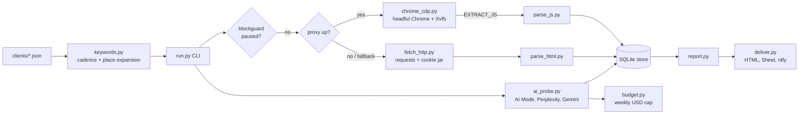

# serp-engine

Self-hosted Google rank tracker that drives a real headful Chrome over the raw Chrome DevTools Protocol, routes traffic through a SOCKS proxy, and records organic positions, SERP features and AI-answer visibility in SQLite.

## Why

Commercial rank trackers are expensive per keyword, opaque about where they measure from, and slow to report AI Overviews or AI-search citations. This project measures from an exit IP you control (for example a residential line behind a SOCKS tunnel), keeps the raw HTML of every SERP for re-parsing, and treats Google blocks as a first-class state so a captcha pauses the whole engine before it burns the IP.

## Architecture



`cdp/` holds a small set of dependency-free Node scripts that reuse the same extraction JavaScript against a local debug Chrome, for one-off snapshots without the database.

## Features

- **Raw CDP, no Playwright.** `chrome_cdp.py` launches `google-chrome` under Xvfb with its own profile and talks to it over a single WebSocket. Fewer automation fingerprints and no driver version coupling.
- **Organic results from `<cite>`.** Google wraps result links in opaque redirects, so the parser reads the visible breadcrumb URL and skips ads (`#tads`), the AI Overview and "People also ask" blocks.
- **SERP features per keyword:** top ads present, local pack present and whether the client appears in it, AI Overview present and whether the client is cited (by linked domain or brand regex), competitor leaderboard of top-10 hosts.
- **Block guard.** Two captchas in one run pause the engine for 12 hours (state stored in SQLite); every entry point checks the pause first. Zero-organic pages count as soft blocks and are not stored, and three of them trigger a "parser drift" alert.
- **Fallback chain.** Chrome through the proxy, then plain HTTPS through the proxy (cookies copied from Chrome, consent form auto-submitted), then direct mode with a reduced keyword set.
- **Pacing.** Randomised 25 to 40 s between pages by default; keywords are shuffled with a per-day seed.
- **Cadences and place expansion.** Keywords run daily, weekly (Monday) or monthly (1st). Patterns like `plumber {place}` expand against a places file in waves.
- **AI-visibility probes.** Google AI Mode via Chrome, Perplexity sonar models via OpenRouter, optional Gemini with Google Search grounding. An LLM extraction step turns each answer into ordered provider names, citation type and accuracy of claims about the client.
- **Budget control.** Paid probe calls are metered from OpenRouter's reported cost and capped per ISO week; unknown cost is booked as a fixed estimate, never as zero.
- **Empty runs alert.** A probe run that stores nothing sends a push instead of silently succeeding.
- **Delivery.** Static HTML report (light and dark), optional publish to a secret web path with `activity.json` and `data.json`, optional Google Sheets tabs (Ranks, Weekly, AI visibility, Keywords), ntfy pushes.
- **Ad-hoc search.** `search.py` exposes the same Chrome, pacing and block guard to other agents as a JSON search API.

## Stack

Python 3.10+, `requests[socks]`, `websocket-client`, SQLite, Google Chrome, Xvfb. Optional: Google Sheets API, OpenRouter, Gemini API, ntfy. Node 22+ for `cdp/`.

## Setup

```bash
python3 -m venv .venv && . .venv/bin/activate
pip install -r requirements.txt
cp .env.example .env            # edit values
cp serp_engine/clients/example.json serp_engine/clients/myclient.json   # edit
```

Linux host for Chrome mode: `google-chrome` and `Xvfb` on PATH. A SOCKS5 proxy on `SERP_PROXY` (for example `ssh -D 1080 user@exit-host`). Without a reachable proxy the engine falls back to direct mode.

## Run

```bash
python serp_engine/run.py --probe                 # smoke test: proxy, Chrome, one SERP
python serp_engine/run.py --dump "plumber springfield"
python serp_engine/run.py --daily [--client example] [--limit 5] [--mode chrome|http|direct]
python serp_engine/run.py --weekly                # daily if missing, AI probes, summary, push
python serp_engine/run.py --ai-probe --surface perplexity
python serp_engine/run.py --status | --unpause | --republish
python serp_engine/search.py --days 7 "query one" "query two"
```

Schedule `--daily` and `--weekly` with cron or systemd timers. Wrap every Chrome-using command in `flock .data/chrome.lock ...` so runs never share the profile.

Standalone snapshots against a local debug Chrome:

```bash
google-chrome --remote-debugging-port=9222 --user-data-dir=/tmp/serp-profile &
node cdp/serp.js ./out keywords.txt [ai_prompts.txt]
node cdp/aio.js ./out "keyword one" "keyword two"
```

## Configuration

| Variable | Default | Purpose |
|---|---|---|
| `SERP_PROXY` | `socks5h://127.0.0.1:1080` | SOCKS proxy for Chrome and HTTP fetches |
| `SERP_GOOGLE_HOST` | `www.google.com` | Google host (e.g. `www.google.de`) |
| `SERP_ACCEPT_LANGUAGE` | `en-US,en;q=0.9` | HTTP fallback language header |
| `SERP_PACE_MIN` / `SERP_PACE_MAX` | `25` / `40` | Seconds between page fetches |
| `SERP_CHROME`, `SERP_CHROME_LANG` | `/usr/bin/google-chrome`, `en-US` | Chrome binary and UI language |
| `SERP_DISPLAY`, `SERP_CDP_PORT`, `SERP_PROFILE` | `:78`, `9333`, `.data/chrome-profile-serp` | Xvfb display, DevTools port, profile dir |
| `SERP_DATA_DIR` | `.data` | SQLite DB, logs, HTML dumps, screenshots |
| `SERP_CLIENTS_DIR` | `serp_engine/clients` | Client JSON configs |
| `OPENROUTER_API_KEY` | | Perplexity probes |
| `GEMINI_API_KEY`, `GEMINI_API_KEY_FREE` | | Answer extraction and grounded probes |
| `SERP_LLM_MODELS` | Gemini flash chain | Model chain for extraction |
| `SERP_PPLX_MODEL`, `SERP_OAI_MODEL` | `perplexity/sonar`, `perplexity/sonar-pro` | Models per probe surface |
| `SERP_AI_WEEKLY_USD` | `0.50` | Weekly cap for paid probes |
| `SERP_SHEET_ID`, `GOOGLE_TOKEN_PATH` | | Optional Sheets delivery (OAuth user token) |
| `SERP_WEB_ROOT`, `SERP_WEB_BASE`, `SERP_WEB_TOKEN` | | Optional static publish under a secret path |
| `NTFY_SERVER`, `SERP_NTFY_TOPIC` | `https://ntfy.sh` | Optional push notifications |

Client config fields (see `serp_engine/clients/example.json`): `id`, `label`, `domain`, `aliases`, `brand_regex`, `topic`, `location` (`hl`, `gl`, `uule_name`, `country`, `city`), `groups` (`pages`, `label`), `keywords`, `place_patterns`, `place_expand`, `ai_prompts`, optional `kpi_goal`. The keyword in group `kpi` gets a sparkline and a daily screenshot.

## Limitations

- Google markup changes break selectors. Raw HTML is kept gzipped per keyword so you can re-parse history after a fix.
- The JS extractor undercounts ads on some layouts; for ad analysis, parse the saved HTML (`#tads`, `adurl=`).
- The HTML fallback parser does not detect AI Overviews or local-pack membership.
- Label regexes cover the English and German Google UI only.
- AI Overview citations often appear as names without links; the brand regex catches those, domain matching does not.
- One Chrome profile, one process: runs are sequential by design.
- Automated querying of Google may violate its terms of service. Use responsibly and at low volume.

## License

MIT
